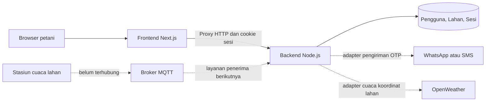

# Bayer Seed-to-Harvest Planner

Aplikasi berbahasa Indonesia untuk manajemen multi-lahan, simulasi cuaca per lokasi,
jadwal tanam, dan perhitungan campuran satu produk. Frontend dan backend merupakan **dua layanan terpisah** dalam satu
repositori (npm workspaces).

## Arsitektur

```text
Browser
  │
  ▼
frontend/ — Next.js, React, TypeScript, Tailwind (localhost:3000)
  │ /api/* diteruskan melalui proxy HTTP
  ▼
backend/  — Node.js + TypeScript API (127.0.0.1:4000)
  ├─ Katalog 8 tanaman, 4 produk, dan 4 skenario cuaca
  ├─ Perhitungan jadwal dan penundaan akibat hujan
  └─ Validasi serta perhitungan dosis dan air per tangki

shared/   — Kontrak tipe permintaan/respons TypeScript
tests/    — Pengujian logika, HTTP API, dan browser
```

Frontend mengambil katalog dan hasil perhitungan dari backend. Rumus dosis,
algoritma penjadwalan, dan data katalog tidak diimpor ke kode browser.
Frontend hanya memeriksa isian dasar, mengatur tampilan, dan memformat angka/tanggal.
Backend selalu memvalidasi ulang data, termasuk permintaan langsung ke API.
Folder `shared/` hanya berisi tipe; tidak memiliki data atau rumus.

## Menjalankan dari VS Code

Gunakan Node.js **24.x**. Buka terminal pada folder
`seed-to-harvest-planner` (folder yang berisi README ini):

```powershell
npm install
npm run dev
```

Buka **http://localhost:3000**. Perintah kedua menjalankan kedua layanan sekaligus.
Pada layar masuk, pilih **Gunakan nomor contoh → Lanjutkan → Gunakan kode contoh →
Masuk ke lahan saya**. Selanjutnya pilih **Coba dengan 3 lahan contoh** atau
**Tambah lahan**. OTP belum dikirim melalui WhatsApp/SMS; seluruh kode pada alur ini
adalah simulasi dan tidak membuktikan kepemilikan nomor.
Tekan **Ctrl+C** untuk menghentikannya. Jika salah satu layanan berhenti, peluncur
juga menghentikan layanan lainnya.

Untuk menjalankan secara terpisah, gunakan dua terminal pada folder proyek:

```powershell
# Terminal pertama
npm run dev:backend
```

```powershell
# Terminal kedua
npm run dev:frontend
```

Backend dapat diperiksa langsung di **http://127.0.0.1:4000/api/health**.
Jika port 3000 atau 4000 sudah dipakai versi aplikasi lama, hentikan terminal
aplikasi lama terlebih dahulu.

## Konfigurasi

Nilai bawaan sudah dapat digunakan tanpa file konfigurasi tambahan.
Untuk mengganti alamat, salin `backend/.env.example` ke `backend/.env` dan
`frontend/.env.example` ke `frontend/.env.local`.

| Lokasi | Variabel | Bawaan |
| --- | --- | --- |
| Backend | `HOST` | `127.0.0.1` |
| Backend | `PORT` | `4000` |
| Frontend | `BACKEND_URL` | `http://127.0.0.1:4000` |
| Backend | `DATABASE_PATH` | `data/juragan.sqlite` relatif terhadap folder backend |
| Backend | `FRONTEND_ORIGINS` | `http://localhost:3000,http://127.0.0.1:3000` |
| Backend | `COOKIE_SECURE` | `false` untuk HTTP lokal; gunakan `true` pada HTTPS |

`BACKEND_URL` adalah alamat yang diakses **server Next.js**, bukan browser.
Browser memakai alamat relatif `/api/...`, sehingga tidak membutuhkan pengaturan
CORS untuk alur aplikasi ini. Ubah `HOST` menjadi `0.0.0.0` apabila backend harus
diakses dari layanan/container lain, dan sesuaikan `BACKEND_URL` di frontend.
Setelah mengubah konfigurasi, restart mode development; untuk produksi,
build ulang frontend agar tujuan proxy diperbarui.

## API

| Metode | Alamat | Fungsi |
| --- | --- | --- |
| GET | `/api/health` | Memeriksa layanan |
| GET | `/api/catalog` | Tanaman, produk, dan skenario cuaca |
| POST | `/api/timeline` | Membuat jadwal dan daftar kegiatan perlu ditinjau |
| POST | `/api/tank-mix` | Menghitung kebutuhan produk dan air |
| POST | `/api/auth/request-otp` | Membuat kode simulasi; isi `nomorHp` dan `kanal` (`whatsapp`/`sms`) |
| POST | `/api/auth/verify-otp` | Verifikasi `id` tantangan dan `kode`; membuat cookie sesi |
| GET | `/api/auth/session` | Pengguna saat ini atau `null` |
| POST | `/api/auth/logout` | Menghapus sesi; isi `{}` |
| GET / POST | `/api/lahan` | Daftar lahan milik pengguna / tambah lahan |
| POST | `/api/lahan/contoh` | Membuat tiga lahan contoh jika belum ada; isi `{}` |
| GET | `/api/lahan/:id/cuaca` | Memeriksa pemilik lalu mengambil cuaca koordinat lahan |

Permintaan POST menggunakan `Content-Type: application/json`, maksimal 16 KiB.
Contoh isi permintaan jadwal:

```json
{
  "seedId": "padi-demo",
  "startDate": "2026-11-01",
  "scenario": "mixed",
  "harvestDayOffset": 110
}
```

Contoh isi permintaan kalkulator (angka contoh, bukan rekomendasi dosis):

```json
{
  "productId": "nativo",
  "area": "1",
  "capacity": "15",
  "dose": "400",
  "water": "200"
}
```

Isian kalkulator adalah string agar format Indonesia seperti `"0,5"` tetap
diterima. Satuan produk ditentukan katalog backend. Dosis per hektare dan volume
air per hektare tetap dimasukkan pengguna berdasarkan label yang sesuai.
Setiap pengisian memiliki dosis **dan air** yang dibagi rata; tangki tidak harus penuh.

Respons sukses langsung berisi objek katalog, `TimelineReport`, atau
`TankMixResult`. Kesalahan memakai bentuk
`{ "error": { "code": "...", "message": "...", "fields": {} } }`;
`fields` hanya disertakan untuk kesalahan isian kalkulator.
Status HTTP: 400 isian/JSON tidak valid, 404 alamat tidak tersedia,
405 metode tidak didukung, 413 data terlalu besar, 415 format bukan JSON,
dan 500 gangguan internal.

## Build dan pengujian

```powershell
npm run typecheck
npm test
npm run test:ui
npm run build
npm start
```

`npm start` menjalankan backend hasil kompilasi dan frontend hasil build.
Masing-masing juga dapat dijalankan dengan `npm run start:backend` dan
`npm run start:frontend`. Kedua layanan dapat dipasang pada server berbeda;
gunakan monorepo ini sebagai sumber build dan arahkan proxy frontend ke backend.

Tes browser memakai Microsoft Edge yang terpasang di Windows. Playwright
menjalankan layanan terpisah pada port 3100/4100 dengan database dalam memori
dan folder build `frontend/.next-e2e/`. Data aplikasi tidak dipakai oleh tes.
Hasil tangkapan layar tersimpan di `output/ui-review/`.

## Modul multi-lahan

- Kontrak `Pengguna`, `Lahan`, `PenggunaDenganLahan`, dan `CuacaLahan`:
  `shared/src/juragan.ts`.
- Skema tabel dan relasi satu pengguna → banyak lahan:
  `backend/src/juragan/skema.ts`. Kunci asing, indeks pemilik, dan topik MQTT unik
  disiapkan. Topik berbentuk `juragan/{penggunaId}/lahan/{id}/cuaca`.
- Penyimpanan SQLite: `backend/src/juragan/database.ts`. Data pengguna, lahan,
  dan sesi tersimpan di file lokal dan bertahan setelah restart.
- Alur OTP: `backend/src/juragan/otp.ts`. Kode acak enam angka, berlaku lima
  menit, maksimal lima percobaan, jeda kirim ulang 60 detik, dan satu kali pakai.
  Sesi delapan jam memakai token acak dalam cookie HttpOnly/SameSite; database
  hanya menyimpan hash token. Tantangan OTP dan pembatas permintaan berada di
  memori satu proses; tantangan harus dibuat ulang setelah backend restart.
- Cuaca: fungsi asinkron `ambilCuacaLahan(latitude, longitude)` pada
  `backend/src/juragan/cuaca.ts`. Transport `fetchCuacaSimulasi` meniru respons
  cuaca saat ini dan prakiraan tiga jam tanpa koneksi internet. Cache satu menit
  dipisahkan menurut koordinat. Galat tidak diubah menjadi status cerah.
- UI: `frontend/src/components/juragan/` berisi `LoginNomorHp`,
  `DashboardJuragan`, `KartuLahan`, dan `FormLahan`.

Setiap kartu melakukan permintaan HTTP sendiri. Backend mengambil latitude dan
longitude dari lahan yang dimiliki pengguna; ID pemilik dari browser tidak dipercaya.
Aplikasi tidak membaca lokasi GPS perangkat. Kartu hujan menampilkan
**Tunda Penyemprotan Obat!**; kartu gagal memiliki tombol coba ulang tersendiri.
Tombol jadwal mengisi tanaman, tanggal tanam, dan hari panen dari lahan;
kalkulator mengisi luas lahan aktif. Perubahan pada simulasi jadwal/kalkulator
masih sementara, terpisah dari data aset yang disimpan.

## Menghubungkan layanan sungguhan



OTP, cuaca, pasangan produk-tanaman, dan umur kegiatan masih simulasi.
Untuk autentikasi nyata, implementasikan penyedia pengiriman/verifikasi nomor
dan hapus pengembalian `kodeSimulasi` dari respons. Integrasi ini memerlukan
akun penyedia serta kredensial backend; kredensial tidak boleh masuk kode frontend.
Server menolak `NODE_ENV=production` selama OTP belum diganti, kecuali
`ALLOW_DEMO_AUTH=true` dipilih secara eksplisit untuk demo terkontrol.

Untuk cuaca nyata, ganti transport simulasi dan petakan respons aktual provider,
termasuk pembulatan koordinat, timestamp, nilai hilang, dan galat. OpenWeather
memakai parameter `lat`/`lon`; peluang hujan `pop` ada pada respons prakiraan
dan bernilai 0–1, sehingga berbeda dari volume hujan.
Rujukan: [cuaca saat ini](https://openweathermap.org/api/current) dan
[prakiraan tiga jam](https://openweathermap.org/api/forecast5).

Implementasi lokal menggunakan satu proses backend dan database SQLite.
Modul SQLite Node 24 masih berstatus eksperimental menurut
[dokumentasi Node.js](https://nodejs.org/download/release/v24.14.0/docs/api/sqlite.html).
Untuk banyak instans backend, pindahkan tantangan OTP, pembatas permintaan,
dan cache ke penyimpanan bersama serta gunakan database layanan bersama.
Integrasi MQTT memerlukan kredensial perangkat dan pembatasan akses topik per pemilik;
menyimpan nama topik belum membuat sensor tersambung.

Untuk mengunggah kode dan membagikan tautan website, lihat [DEPLOYMENT.md](DEPLOYMENT.md).
