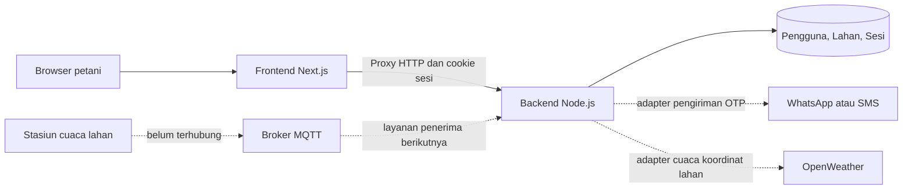

# Cyphera - Platform Manajemen Pertanian

Aplikasi berbahasa Indonesia untuk manajemen multi-lahan, simulasi cuaca per lokasi,
jadwal tanam, dan perhitungan campuran satu produk. Frontend dan backend merupakan **dua layanan terpisah** dalam satu
repositori (npm workspaces).

## Deploy paling mudah: GitHub Pages

Tersedia versi **aplikasi statis tanpa backend**. Cukup unggah proyek, pilih
**Settings → Pages → Source: GitHub Actions**, lalu jalankan workflow
**Deploy website ke GitHub Pages** pada tab **Actions**. Push selanjutnya ke `main`
akan menerbitkan pembaruan otomatis. [Panduan singkat](DEPLOYMENT.md#cara-paling-mudah-github-pages-aplikasi-tanpa-backend).

Dashboard langsung terbuka tanpa login atau nomor HP. Data lahan hanya tersimpan
di browser masing-masing dan cuaca tetap simulasi. Tidak memerlukan Render,
Vercel, atau kartu pembayaran. Build lokal: `npm run build:pages`.

## Arsitektur

```text
Browser
  │
  ▼
frontend/ — Next.js, React, TypeScript, Tailwind (localhost:3000)
  │ /api/* diteruskan melalui proxy HTTP
  ▼
backend/  — Node.js + TypeScript API (127.0.0.1:4000)
  ├─ Katalog 8 tanaman, 4 produk, dan 4 skenario cuaca
  ├─ Perhitungan jadwal dan penundaan akibat hujan
  └─ Validasi serta perhitungan dosis dan air per tangki

shared/   — Kontrak tipe permintaan/respons TypeScript
tests/    — Pengujian logika, HTTP API, dan browser
```

Dalam mode dua layanan, frontend mengambil katalog dan hasil perhitungan dari backend. Rumus dosis,
algoritma penjadwalan, dan data katalog tidak diimpor ke kode browser.
Frontend hanya memeriksa isian dasar, mengatur tampilan, dan memformat angka/tanggal.
Backend selalu memvalidasi ulang data, termasuk permintaan langsung ke API.
Folder `shared/` hanya berisi tipe; tidak memiliki data atau rumus.
Khusus mode GitHub Pages, browser memakai modul rumus yang sama secara lokal
melalui adapter lokal, tanpa memuat server Node.js atau database SQLite.

## Menjalankan dari VS Code

Gunakan Node.js **24.x**. Buka terminal pada folder
`seed-to-harvest-planner` (folder yang berisi README ini):

```powershell
npm install
npm run dev
```

Buka **http://localhost:3000**. Perintah kedua menjalankan kedua layanan sekaligus.
Pada layar masuk, pilih **Gunakan nomor contoh → Lanjutkan → Gunakan kode contoh →
Masuk ke lahan saya**. Selanjutnya pilih **Coba dengan 3 lahan contoh** atau
**Tambah lahan**. OTP belum dikirim melalui WhatsApp/SMS; seluruh kode pada alur ini
adalah simulasi dan tidak membuktikan kepemilikan nomor.
Tekan **Ctrl+C** untuk menghentikannya. Jika salah satu layanan berhenti, peluncur
juga menghentikan layanan lainnya.

Untuk menjalankan secara terpisah, gunakan dua terminal pada folder proyek:

```powershell
# Terminal pertama
npm run dev:backend
```

```powershell
# Terminal kedua
npm run dev:frontend
```

Backend dapat diperiksa langsung di **http://127.0.0.1:4000/api/health**.
Jika port 3000 atau 4000 sudah dipakai versi aplikasi lama, hentikan terminal
aplikasi lama terlebih dahulu.

## Konfigurasi

Nilai bawaan sudah dapat digunakan tanpa file konfigurasi tambahan.
Untuk mengganti alamat, salin `backend/.env.example` ke `backend/.env` dan
`frontend/.env.example` ke `frontend/.env.local`.

| Lokasi | Variabel | Bawaan |
| --- | --- | --- |
| Backend | `HOST` | `127.0.0.1` |
| Backend | `PORT` | `4000` |
| Frontend | `BACKEND_URL` | `http://127.0.0.1:4000` |
| Backend | `DATABASE_PATH` | `data/juragan.sqlite` relatif terhadap folder backend |
| Backend | `FRONTEND_ORIGINS` | `http://localhost:3000,http://127.0.0.1:3000` |
| Backend | `COOKIE_SECURE` | `false` untuk HTTP lokal; gunakan `true` pada HTTPS |

`BACKEND_URL` adalah alamat yang diakses **server Next.js**, bukan browser.
Browser memakai alamat relatif `/api/...`, sehingga tidak membutuhkan pengaturan
CORS untuk alur aplikasi ini. Ubah `HOST` menjadi `0.0.0.0` apabila backend harus
diakses dari layanan/container lain, dan sesuaikan `BACKEND_URL` di frontend.
Setelah mengubah konfigurasi, restart mode development; untuk produksi,
build ulang frontend agar tujuan proxy diperbarui.

## API

| Metode | Alamat | Fungsi |
| --- | --- | --- |
| GET | `/api/health` | Memeriksa layanan |
| GET | `/api/catalog` | Tanaman, produk, dan skenario cuaca |
| POST | `/api/timeline` | Membuat jadwal dan daftar kegiatan perlu ditinjau |
| POST | `/api/tank-mix` | Menghitung kebutuhan produk dan air |
| POST | `/api/auth/request-otp` | Membuat kode simulasi; isi `nomorHp` dan `kanal` (`whatsapp`/`sms`) |
| POST | `/api/auth/verify-otp` | Verifikasi `id` tantangan dan `kode`; membuat cookie sesi |
| GET | `/api/auth/session` | Pengguna saat ini atau `null` |
| POST | `/api/auth/logout` | Menghapus sesi; isi `{}` |
| GET / POST | `/api/lahan` | Daftar lahan milik pengguna / tambah lahan |
| POST | `/api/lahan/contoh` | Membuat tiga lahan contoh jika belum ada; isi `{}` |
| GET | `/api/lahan/:id/cuaca` | Memeriksa pemilik lalu mengambil cuaca koordinat lahan |

Permintaan POST menggunakan `Content-Type: application/json`, maksimal 16 KiB.
Contoh isi permintaan jadwal:

```json
{
  "seedId": "padi-demo",
  "startDate": "2026-11-01",
  "scenario": "mixed",
  "harvestDayOffset": 110
}
```

Contoh isi permintaan kalkulator (angka contoh, bukan rekomendasi dosis):

```json
{
  "productId": "nativo",
  "area": "1",
  "capacity": "15",
  "dose": "400",
  "water": "200"
}
```

Isian kalkulator adalah string agar format Indonesia seperti `"0,5"` tetap
diterima. Satuan produk ditentukan katalog backend. Dosis per hektare dan volume
air per hektare tetap dimasukkan pengguna berdasarkan label yang sesuai.
Setiap pengisian memiliki dosis **dan air** yang dibagi rata; tangki tidak harus penuh.

Respons sukses langsung berisi objek katalog, `TimelineReport`, atau
`TankMixResult`. Kesalahan memakai bentuk
`{ "error": { "code": "...", "message": "...", "fields": {} } }`;
`fields` hanya disertakan untuk kesalahan isian kalkulator.
Status HTTP: 400 isian/JSON tidak valid, 404 alamat tidak tersedia,
405 metode tidak didukung, 413 data terlalu besar, 415 format bukan JSON,
dan 500 gangguan internal.

## Build dan pengujian

```powershell
npm run typecheck
npm test
npm run test:ui
npm run build
npm start
```

`npm start` menjalankan backend hasil kompilasi dan frontend hasil build.
Masing-masing juga dapat dijalankan dengan `npm run start:backend` dan
`npm run start:frontend`. Kedua layanan dapat dipasang pada server berbeda;
gunakan monorepo ini sebagai sumber build dan arahkan proxy frontend ke backend.

Tes browser memakai Microsoft Edge yang terpasang di Windows. Playwright
menjalankan layanan terpisah pada port 3100/4100 dengan database dalam memori
dan folder build `frontend/.next-e2e/`. Data aplikasi tidak dipakai oleh tes.
Hasil tangkapan layar tersimpan di `output/ui-review/`.

## Modul multi-lahan

- Kontrak `Pengguna`, `Lahan`, `PenggunaDenganLahan`, dan `CuacaLahan`:
  `shared/src/juragan.ts`.
- Skema tabel dan relasi satu pengguna → banyak lahan:
  `backend/src/juragan/skema.ts`. Kunci asing, indeks pemilik, dan topik MQTT unik
  disiapkan. Topik berbentuk `juragan/{penggunaId}/lahan/{id}/cuaca`.
- Penyimpanan SQLite: `backend/src/juragan/database.ts`. Data pengguna, lahan,
  dan sesi tersimpan di file lokal dan bertahan setelah restart.
- Alur OTP: `backend/src/juragan/otp.ts`. Kode acak enam angka, berlaku lima
  menit, maksimal lima percobaan, jeda kirim ulang 60 detik, dan satu kali pakai.
  Sesi delapan jam memakai token acak dalam cookie HttpOnly/SameSite; database
  hanya menyimpan hash token. Tantangan OTP dan pembatas permintaan berada di
  memori satu proses; tantangan harus dibuat ulang setelah backend restart.
- Cuaca: fungsi asinkron `ambilCuacaLahan(latitude, longitude)` pada
  `backend/src/juragan/cuaca.ts`. Transport `fetchCuacaSimulasi` meniru respons
  cuaca saat ini dan prakiraan tiga jam tanpa koneksi internet. Cache satu menit
  dipisahkan menurut koordinat. Galat tidak diubah menjadi status cerah.
- UI: `frontend/src/components/juragan/` berisi `LoginNomorHp`,
  `DashboardJuragan`, `KartuLahan`, dan `FormLahan`.

Setiap kartu melakukan permintaan HTTP sendiri. Backend mengambil latitude dan
longitude dari lahan yang dimiliki pengguna; ID pemilik dari browser tidak dipercaya.
Aplikasi tidak membaca lokasi GPS perangkat. Kartu hujan menampilkan
**Tunda Penyemprotan Obat!**; kartu gagal memiliki tombol coba ulang tersendiri.
Tombol jadwal mengisi tanaman, tanggal tanam, dan hari panen dari lahan;
kalkulator mengisi luas lahan aktif. Perubahan pada simulasi jadwal/kalkulator
masih sementara, terpisah dari data aset yang disimpan.

## Menghubungkan layanan sungguhan



OTP, cuaca, pasangan produk-tanaman, dan umur kegiatan masih simulasi.
Untuk autentikasi nyata, implementasikan penyedia pengiriman/verifikasi nomor
dan hapus pengembalian `kodeSimulasi` dari respons. Integrasi ini memerlukan
akun penyedia serta kredensial backend; kredensial tidak boleh masuk kode frontend.
Server menolak `NODE_ENV=production` selama OTP belum diganti, kecuali
`ALLOW_DEMO_AUTH=true` dipilih secara eksplisit untuk demo terkontrol.

Untuk cuaca nyata, ganti transport simulasi dan petakan respons aktual provider,
termasuk pembulatan koordinat, timestamp, nilai hilang, dan galat. OpenWeather
memakai parameter `lat`/`lon`; peluang hujan `pop` ada pada respons prakiraan
dan bernilai 0–1, sehingga berbeda dari volume hujan.
Rujukan: [cuaca saat ini](https://openweathermap.org/api/current) dan
[prakiraan tiga jam](https://openweathermap.org/api/forecast5).

Implementasi lokal menggunakan satu proses backend dan database SQLite.
Modul SQLite Node 24 masih berstatus eksperimental menurut
[dokumentasi Node.js](https://nodejs.org/download/release/v24.14.0/docs/api/sqlite.html).
Untuk banyak instans backend, pindahkan tantangan OTP, pembatas permintaan,
dan cache ke penyimpanan bersama serta gunakan database layanan bersama.
Integrasi MQTT memerlukan kredensial perangkat dan pembatasan akses topik per pemilik;
menyimpan nama topik belum membuat sensor tersambung.

Untuk mengunggah kode dan membagikan tautan website, lihat [DEPLOYMENT.md](DEPLOYMENT.md).

## Ruang kerja GitHub Pages

Dashboard menyediakan ringkasan luas lahan, pekerjaan terbuka, perkiraan panen
30 hari, serta biaya kegiatan selesai. Agenda dibuat pengguna secara manual;
agenda tidak merupakan instruksi penggunaan pestisida. Kegiatan dapat ditandai
selesai dan dibuka kembali. Pencarian, filter tanaman, pengurutan, ubah lahan,
serta tautan peta membantu pengelolaan banyak lokasi.

Cadangan JSON mencakup lahan dan agenda. Impor divalidasi dan menampilkan
pratinjau jumlah data sebelum pengguna memilih penggantian. Penyimpanan memakai
satu dokumen `agri:workspace:v2`; data lahan versi sebelumnya tetap dapat dibaca
serta tidak dihapus saat migrasi. Data tetap lokal di browser, tidak tersinkron
ke server. Gunakan Unduh cadangan untuk pindah perangkat. Cuaca masih simulasi;
umur tanaman dan perkiraan panen berdasarkan kalender, bukan hasil pengamatan.

Verifikasi versi Pages: `npm run build:pages` dengan
`PAGES_BASE_PATH=/seed-to-harvest-planner`, kemudian `npm run test:pages`.

Klinik Tanaman yang aktif menyediakan pratinjau foto dan catatan pengamatan lokal;
analisis AI belum diaktifkan. Implementasi API terpisah dijelaskan dalam
[panduan Klinik Tanaman](KLINIK-TANAMAN.md). Semua menu berpindah panel dalam
dashboard yang sama; URL lama `/klinik/`, `/keuangan/`, dan `/riwayat/` tetap tersedia.

Buku Kas Tani dan Riwayat Penyakit tersedia di `/keuangan/` dan `/riwayat/`.
Keduanya bekerja lokal pada GitHub Pages dan ikut cadangan lahan.
Lihat [skema, endpoint, dan panduan fitur](BUKU-KAS-RIWAYAT.md).

## Referensi Bayer Indonesia

Panel `#panduan` memuat 29 identitas produk/referensi arsip, 40 jenis tanaman
yang disebut dalam koleksi, dan 64 pasangan tanaman–sasaran. Penelusuran dilakukan
17 November 2026 terhadap sumber resmi Bayer Indonesia. Ini bukan daftar lengkap
produk yang masih dipasarkan atau pemeriksaan izin edar aktif.

Data terpusat di `backend/src/lib/bayer/products.json`, dipakai bersama oleh
frontend statis dan backend. `source` mempertahankan URL asal penelusuran arsip;
`currentSource` hanya diisi untuk delapan halaman produk yang masih cocok dengan
identitasnya. Sebagian URL lama mengembalikan 404 atau mengalihkan ke produk lain.
Karena itu, tautan arsip ditampilkan sebagai asal data, bukan tombol menuju label
terbaru. Semua angka pada `uses` tetap teks referensi arsip, bukan preset dosis.
Nomor registrasi adalah transkripsi sumber, bukan bukti masa berlaku saat ini.

- Pencarian mencakup produk, bahan aktif, tanaman, kategori, dan sasaran.
- Kalkulator menerima 22 identitas produk semprot; dosis/air tetap manual dari label.
- Perlakuan benih, nematisida perakaran, adjuvan, dan pengatur/aktivator tumbuh
  tidak dimasukkan ke kalkulator semprot per hektare.
- Klinik, jadwal, dan riwayat menampilkan pasangan tanaman–sasaran sebagai bahan
  bacaan, tanpa diagnosis atau resep otomatis.
- Buku Kas dapat menerima nama dan satuan katalog; harga selalu dari pengguna.
  Kemasan otomatis hanya jika satu ukuran diketahui, selain itu harus diisi.
- Roundup dan varietas DEKALB tidak diperkaya dengan spesifikasi/dosis yang belum
  berhasil diverifikasi dari label resmi Indonesia dalam penelusuran ini.

Sumber profil dan kontak: [Bayer Indonesia](https://www.bayer.com/id-id/indonesia),
[kontak resmi](https://www.bayer.com/id-id/indonesia/hubungi-kami),
[program Better Life Farming](https://www.bayer.com/id/id/indonesia-program-better-life-farming).
Sumber identitas awal: [portofolio historis Bayer](https://www.bayer.com/id/id/produk/indonesia-crop-protection).
URL per produk disimpan bersama setiap entri, termasuk catatan perbedaan kadar
Valacor antara halaman bahasa Indonesia dan Inggris serta data yang tidak lengkap.

Perbarui data dengan memeriksa identitas formulasi, negara, tanaman, sasaran,
cara aplikasi, satuan, dan masa berlaku label. Jangan mengganti produk berdasarkan
pengalihan URL, menyamakan g/l dengan g/ha, atau memakai label negara lain.
Uji konsistensi: `node --import tsx --test tests/bayer.test.ts tests/api.test.ts`.

## Ensiklopedia Saku

Panduan Bayer kini menjadi Ensiklopedia Saku pada panel `#panduan`, tetap tanpa
perpindahan halaman atau API tambahan di GitHub Pages. Enam bagian mencakup
Produk, Tanaman, Hama & Penyakit, Panduan Lapangan, Kamus Istilah, dan Tersimpan.
Katalog memuat 29 produk, 40 nama tanaman, serta 21 artikel/istilah (8 pengenalan
gangguan, 5 panduan, 8 istilah). Direktori tanaman menurunkan pasangan sasaran
dari data katalog, bukan mengasumsikan semua produk cocok untuk semua tanaman.

- `frontend/src/lib/encyclopedia.ts`: ringkasan editorial beserta penerbit dan
  URL sumber per artikel. Referensi UC IPM, Kementan, Dinas Pertanian Buleleng,
  IRAC, APVMA, USU, dan EPA digunakan sesuai lingkupnya. Definisi dan biologi
  dari luar negeri tidak menjadi resep atau aturan penggunaan Indonesia.
- `encyclopedia.tsx`: navigasi enam bagian, pencarian per bagian, direktori
  tanaman, dan pembanding identitas maksimal tiga produk.
- `pocket-actions.tsx`: kontrol simpan dan bandingkan yang dipakai bersama
  katalog dan artikel; tidak ada siklus impor komponen.
- Bookmark disimpan di `cyphera:encyclopedia:saved:v1`. Data rusak tidak ditimpa;
  kegagalan menulis tidak dilaporkan sebagai berhasil. Bookmark hanya lokal
  browser, belum termasuk ekspor cadangan lahan atau sinkronisasi akun.
- Pembanding tidak mengurutkan keampuhan, menyarankan pencampuran, atau
  menyamakan takaran. Handoff kalkulator/buku kas tetap hanya membawa identitas.

Pemeriksaan: `npm run typecheck`, `npm run build:pages`, `npm run test:pages`.
Tes browser mencakup bookmark setelah reload, penyimpanan rusak/penuh,
pembanding, pencarian, direktori tanaman, serta regresi handoff fitur lama.

## Animasi interaksi

Komponen di `frontend/src/components/micro-interactions` menggunakan
`framer-motion` dan `react-confetti`. Kalkulator menampilkan rasio air per
pengisian terhadap kapasitas tangki; mengubah input mengosongkan hasil lama.
Jadwal yang dibuka dari lahan tersimpan menyediakan centang selesai selama
tanaman dan tanggal mulai sesuai lahan. Status ditulis ke Agenda Kerja dan
ikut cadangan workspace; tanggal kegiatan adalah tanggal rencana. Konfeti
hanya muncul setelah penyimpanan berhasil, selama tiga detik.

Klinik dashboard tetap tanpa analisis AI dan menampilkan pemindai tidak aktif.
Komponen integrasi API `klinik-tanaman.tsx` memakai laser hanya selama request
analisis berlangsung. Pengaturan reduced motion menonaktifkan konfeti dan
gerakan laser. Timer/listener dibersihkan saat komponen dilepas.

## Tema terang dan gelap

Kontrol Terang / Gelap / Otomatis ada di bagian atas dashboard. Pilihan disimpan
di `cyphera:theme:v1`; mode otomatis mengikuti `prefers-color-scheme`, termasuk
perubahan saat aplikasi terbuka. Skrip kecil di root layout menerapkan tema
sebelum tampilan dirender untuk menghindari kilatan tema terang. Jika penyimpanan
browser dibatasi, tema tetap bisa diganti untuk sesi berjalan dengan pemberitahuan.
Perubahan preferensi juga disinkronkan antar-tab melalui storage event.

`frontend/src/app/theme.css` mengelola token permukaan, teks, batas, dan adaptasi
komponen lama maupun utility Tailwind. Foto dan gradasi cairan tidak dibalik.
Pengujian mencakup semua tujuh panel pada kedua tema, ukuran HP/desktop,
persistensi, preferensi sistem, kegagalan penyimpanan, serta rasio kontras minimal
4,5:1 pada menu aktif, input, kartu hujan, dan pilihan tema. Pemeriksaan ini bukan
audit aksesibilitas menyeluruh untuk semua kondisi konten.

## Undian petani — antarmuka program resmi

Panel `#undian` menyiapkan alur pindai → validasi → satu putaran. Sesuai cakupan
saat ini, nama program resmi Bayer, koneksi validasi, hadiah, dan aturan klaim
belum tersedia. Tombol putar terkunci; tidak ada pemberian hak, pengacakan hadiah,
atau penandaan kode terpakai di browser. Roda dan riwayat adalah tampilan persiapan.

- QR/barcode dibaca lokal menggunakan `@zxing/browser`, dimuat saat diperlukan.
  Kamera meminta izin saat pengguna menekan tombol dan dihentikan ketika ditutup,
  kode ditemukan, berpindah panel, atau komponen dilepas.
- Alternatif: unggah JPG/PNG/WebP maksimal 5 MB atau masukkan kode manual.
- Tautan hasil pindai tidak dibuka otomatis, kode tidak dikirim ke layanan luar,
  tidak ditulis ke localStorage, dan hanya ditampilkan enam karakter terakhir.
  Foto memakai object URL sementara yang dilepas setelah pembacaan.
- `tests/fixtures/scanner-test.png` berisi QR sintetis
  `CYPHERA-SCANNER-TEST-123456`; bukan kode resmi atau kupon berhadiah.

Sebelum mengaktifkan program, dapatkan dokumentasi/API resmi dan autentikasinya,
identitas program, periode, syarat peserta, katalog hadiah, peluang serta alur klaim.
Backend harus memvalidasi kode unik dan menjalankan konsumsi hak putar beserta
pencatatan hasil dalam transaksi atomik dengan constraint unik. Permintaan ulang
harus idempotent: mengembalikan hasil yang sama, bukan mengundi lagi. Pemindaian
barcode produk umum tidak boleh dianggap bukti kemasan unik atau kelayakan.
Jangan menaruh daftar kode sah, kredensial provider, penentu hadiah, atau stok
hadiah di bundle GitHub Pages. Integrasi server ini belum diimplementasikan.
